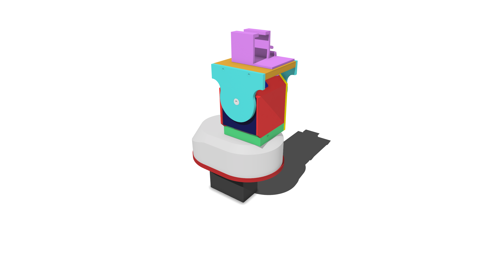
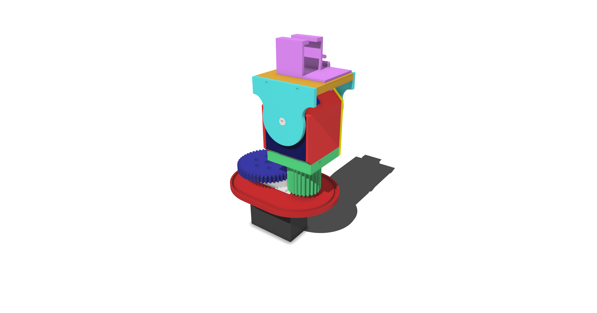
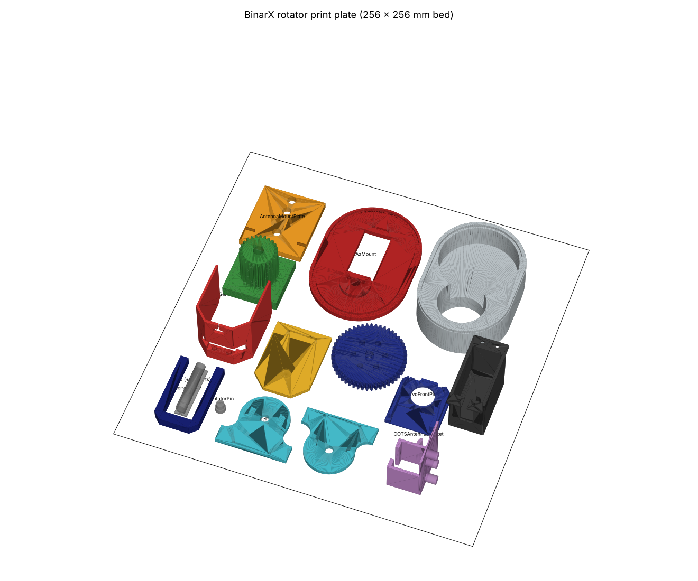

# BinarX Rotator: 3D Printed Parts

3D-printable parts for the BinarX satellite rotator. Assembly and software setup are in the
build guide (SatNOGS_Rotator_Build_Guide.docx).

## Contents

| Path | Description |
| --- | --- |
| `parts/` | One STL per printed part. File names match the build guide. |
| `3mf-and-stl/BinarX_Rot_All_Parts.3mf` | All parts laid out together, for slicing in Bambu Studio / OrcaSlicer. |
| `3mf-and-stl/BinarX_Rot_All_Parts.stl` | All parts combined in a single STL. |
| `docs/SatNOGS_Rotator_Build_Guide.docx` | Build guide: hardware assembly, Arduino code, and SatNOGS setup. |
| `docs/DS3225_270_Upgrade_Guide.docx` | Upgrade for DS3225 270° servos: power, calibration, and checks for 360° motion without overshoot. |
| `arduino/rotator_180.ino` | Arduino sketch for standard 180° servos (the sketch in the build guide). |
| `arduino/rotator_270.ino` | Arduino sketch for DS3225 270° servos (replaces the 180° sketch in the build guide). |

## Parts

| File | Qty | Used in build steps |
| --- | --- | --- |
| AzServoCasing.stl | 1 | 1 |
| ElRod_flat_with_supports.stl | 1 | 2, 16 |
| AzMount.stl | 1 | 2, 3, 4, 15, 16 |
| LargeGear.stl | 1 | 5, 6, 7, 14b |
| SmallGearBase.stl | 1 | 8, 9, 10 |
| ServoBrace.stl | 1 | 9 |
| RearPlate.stl | 1 | 10 |
| ElServoCover.stl | 1 | 11, 12 |
| ElServoFrontPlate.stl | 1 | 11 |
| AntennaMountPlate.stl | 1 | 13 |
| ElArmSidePlate_x2.stl | 2 | 13, 14a, 14b |
| ElRotatorPin.stl | 1 | 14a |
| AzProtectionCover.stl | 1 | 15 |
| COTSAntennaBracket.stl | 1 | 17 |

Total: 15 printed parts. `ElRod.stl` is the same rod without built-in supports, if you prefer to use slicer supports.

## Hardware

- 12 x M2x10 screws (steps 4, 9, 10, 13)
- 2 servos (same model for azimuth and elevation), with the horn and screws supplied with them

`COTSAntennaBracket.stl` is printed; it holds a commercial off-the-shelf (COTS) antenna.

## Print plate

`3mf-and-stl/BinarX_Rot_All_Parts.3mf` has every part as a named object, already oriented for printing and spaced at least 3 mm apart. It fits a 256 x 256 mm bed.

- **ElRod** prints lying down on built-in sacrificial supports. The rod sits 3 mm above the bed with a 0.35 mm gap to the supports. Snap them off and sand the underside before gluing.
- **AzProtectionCover** prints upside down, so its locating tongue is at the top of the print.

## Fit changes (November 2026)

| Part | Change | Why |
| --- | --- | --- |
| AzProtectionCover | Locating tongue narrowed by 0.15 mm on each face | It fitted the AzMount groove with only 0.1 mm per side; now about 0.25 mm per side |
| SmallGearBase | Rod bore 7.0 mm -> 7.3 mm | Running fit on the 6.8 mm rod (0.5 mm clearance) so the elevation assembly turns freely |
| ElServoFrontPlate | Outline trimmed 0.1 mm per side; spline opening 14.2 mm -> 16.5 mm, moved 0.6 mm towards the roof | Slides into the shroud with 0.3 mm per side and clears the servo's spline boss. Test-fit on your servo |
| ElRod | New version with built-in supports | Prints horizontally for a stronger rod |

The gear mesh (50 and 25 teeth, module 1) needs a 37.5 mm centre distance. That works when the azimuth servo's spline is 10.6 mm from the centre of the servo body. If your gears bind, measure that distance on your servo.

## Servo upgrade

If you use DS3225 270° servos, follow `docs/DS3225_270_Upgrade_Guide.docx` and use `arduino/rotator_270.ino`. Power the servos from a separate 6 V supply, not from the Arduino.

## Licences

This repo uses a different licence for each kind of content:

| Content | Licence | File |
| --- | --- | --- |
| Printable parts (`parts/`, `3mf-and-stl/`) | CERN-OHL-S-2.0 | [LICENSE-HARDWARE.md](LICENSE-HARDWARE.md) |
| Arduino code | MIT | [LICENSE-CODE.txt](LICENSE-CODE.txt) |
| Build guide (`docs/`) | CC BY-SA 4.0 | [LICENSE-GUIDE.md](LICENSE-GUIDE.md) |
