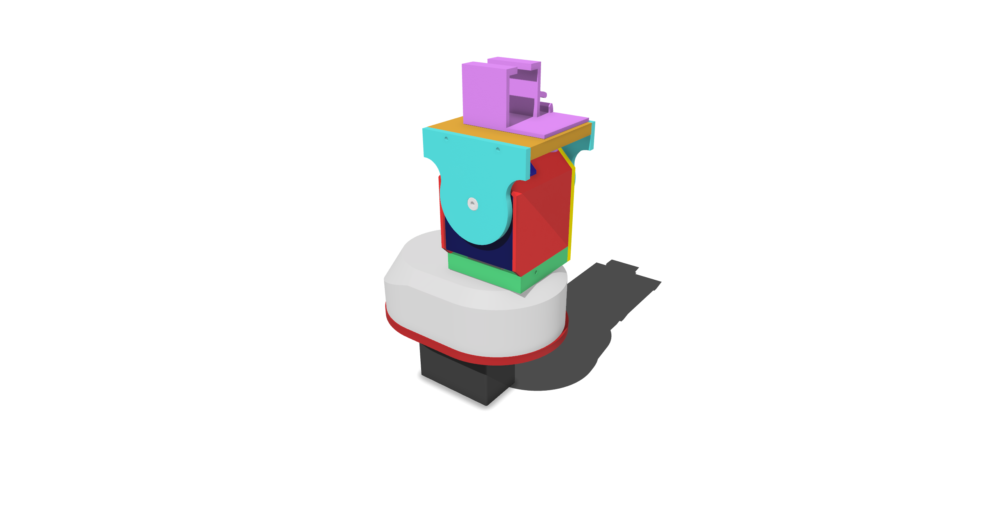
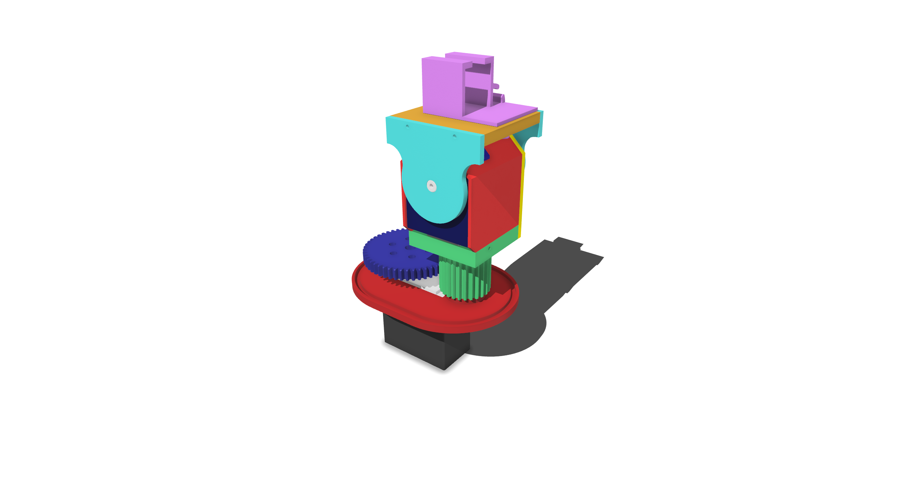

# BinarX Rotator: 3D Printed Parts

3D-printable parts for the BinarX satellite rotator. Assembly and software setup are in the
build guide (SatNOGS_Rotator_Build_Guide.docx).

## Contents

| Path | Description |
| --- | --- |
| `parts/` | One STL per printed part. File names match the build guide. |
| `3mf-and-stl/BinarX_Rot_All_Parts.3mf` | All parts laid out together, for slicing in Bambu Studio / OrcaSlicer. |
| `3mf-and-stl/BinarX_Rot_All_Parts.stl` | All parts combined in a single STL. |
| `docs/SatNOGS_Rotator_Build_Guide.docx` | Build guide: hardware assembly, Arduino code, and SatNOGS setup. |

## Parts

| File | Qty | Used in build steps |
| --- | --- | --- |
| AzServoCasing.stl | 1 | 1 |
| ElRod.stl | 1 | 2, 16 |
| AzMount.stl | 1 | 2, 3, 4, 15, 16 |
| LargeGear.stl | 1 | 5, 6, 7, 14b |
| SmallGearBase.stl | 1 | 8, 9, 10 |
| ServoBrace.stl | 1 | 9 |
| RearPlate.stl | 1 | 10 |
| ElServoCover.stl | 1 | 11 |
| ElServoFrontPlate.stl | 1 | 12 |
| AntennaMountPlate.stl | 1 | 13 |
| ElArmSidePlate_x2.stl | 2 | 13, 14a, 14b |
| ElRotatorPin.stl | 1 | 14a |
| AzProtectionCover.stl | 1 | 15 |
| COTSAntennaBracket.stl | 1 | 17 |

Total: 15 printed parts.

## Hardware

- 12 x M2x10 screws (steps 4, 9, 10, 13)
- 2 servos (same model for azimuth and elevation), with the horn and screws supplied with them

Parts marked COTS (commercial off-the-shelf) are bought, not printed.

## Licences

This repo uses a different licence for each kind of content:

| Content | Licence | File |
| --- | --- | --- |
| Printable parts (`parts/`, `3mf-and-stl/`) | CERN-OHL-S-2.0 | [LICENSE-HARDWARE.md](LICENSE-HARDWARE.md) |
| Arduino code | MIT | [LICENSE-CODE.txt](LICENSE-CODE.txt) |
| Build guide (`docs/`) | CC BY-SA 4.0 | [LICENSE-GUIDE.md](LICENSE-GUIDE.md) |
